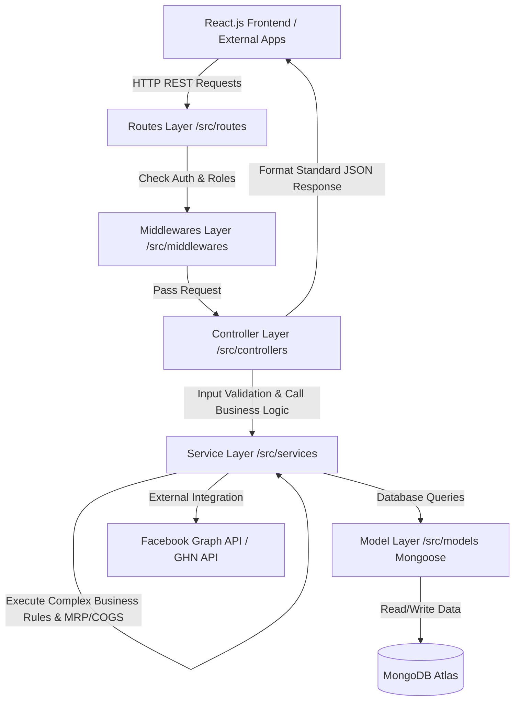

# 👕 AraWMS – AraStore Fashion Warehouse Management System (Backend Service)

> **Hệ thống Quản lý Kho Thời trang Tập trung & Vận hành Sản xuất Chuyên biệt cho AraStore**

---

##  Mục lục
1. [Giới thiệu Dự án]
2. [Công nghệ Sử dụng (Tech Stack)]
3. [Kiến trúc Code (Code Architecture)]
4. [Cấu trúc Thư mục Dự án]
5. [Phân công Nhiệm vụ (Team Members & Responsibilities)]
6. [Phạm vi & Các Module Nghiệp vụ Chính]
7. [Hệ thống Phân quyền (RBAC)]
8. [Tích hợp Bên thứ ba (3rd Party Integrations)]
9. [Hướng dẫn Cài đặt & Khởi chạy]

---

##  Giới thiệu Dự án

**AraWMS (AraStore Warehouse Management System)** là giải pháp phần mềm quản lý kho và vận hành sản xuất thời trang chuyên biệt. Hệ thống được thiết kế nhằm số hóa và tập trung hóa toàn bộ chuỗi cung ứng:
* **Quản lý Vật tư & Vải cuộn độc bản**: Mã hóa Barcode từng cuộn vải, quản lý vị trí kho theo định dạng Zone / Rack / Bin và tận dụng tối đa vải vụn/cuộn dở.
* **Kỹ thuật May, BOM & MRP**: Quản lý định mức kỹ thuật (BOM), tính toán nhu cầu nguyên vật liệu (MRP) và kiểm soát tỷ lệ hao hụt vải (vượt 3% phải duyệt cấp chủ shop).
* **Social Commerce LiveChat**: Tích hợp Facebook Messenger LiveChat giúp kiểm tra tồn kho real-time theo SKU và chốt đơn tự động giữ kho.
* **Fulfillment & Quản lý Đổi trả**: Hỗ trợ Pick-list, in vận đơn, bàn giao vận chuyển (GHN/GHTK) và kiểm tra phân loại hàng đổi trả (sạc 0% nếu bẩn/mất tag).
* **Kế toán Quản trị & P&L Real-time**: Tự động tính giá vốn hàng bán (COGS), đối soát chênh lệch COD và xuất báo cáo Lợi nhuận P&L thời gian thực.

---

##  Công nghệ Sử dụng (Tech Stack)

### Backend Service (Chính)
| Thành phần | Công nghệ | Mô tả / Mục đích sử dụng |
| :--- | :--- | :--- |
| **Runtime Environment** | Node.js (v18+) | Môi trường thực thi JavaScript server-side |
| **Web Framework** | Express.js | Framework chính để xây dựng RESTful APIs (sử dụng ES Modules `import/export`) |
| **Database** | MongoDB Atlas | Cơ sở dữ liệu NoSQL đám mây linh hoạt |
| **ODM Framework** | Mongoose ODM | Quản lý schema, mối quan hệ dữ liệu & query MongoDB |
| **Authentication** | JSON Web Token (JWT) & BcryptJS | Xác thực người dùng và mã hóa mật khẩu an toàn |
| **Security & Middleware** | CORS, Express-JSON, Express-Urlencoded | Kiểm soát truy cập cross-origin và parse request payload |
| **Logging & Tools** | Morgan, Dotenv, Nodemon | Ghi log HTTP Request môi trường Dev, quản lý biến môi trường và Hot-reload |

### Ecosystem & Client Layer
| Layer | Technology | Usage |
| :--- | :--- | :--- |
| **Frontend** | React.js (Single Page Application) | Giao diện người dùng Web App |
| **State Management** | Redux Toolkit / Zustand | Quản lý trạng thái client-side tập trung |
| **UI Library** | TailwindCSS / Ant Design | Thiết kế giao diện hiện đại, responsive |
| **HTTP Client** | Axios | Gửi request tương tác REST API backend |
| **Social API** | Facebook Graph API & Messenger API | Tích hợp tin nhắn, LiveChat và CSKH |
| **Logistics API** | GHN / GHTK / Viettel Post API | Kết nối tạo đơn hàng và đẩy thông tin vận chuyển |

---

## Kiến trúc Code (Code Architecture)

Hệ thống Backend ARAWMS được thiết kế theo kiến trúc **Layered Architecture (Phân lớp)** kết hợp mô hình **Controller - Service - Model Pattern** nhằm tối ưu tính mở rộng, dễ bảo trì và tách biệt rõ ràng giữa Business Logic và Data Access Layer.



### Chi tiết Phân lớp Architecture:
1. **Routes Layer (`/src/routes`)**: Định nghĩa các API endpoints (URL pattern & HTTP methods), ánh xạ request tới middleware xác thực và controller tương ứng.
2. **Middlewares Layer (`/src/middlewares`)**:
   - `authMiddleware.js`: Xác thực JWT Token, phân quyền người dùng theo vai trò (RBAC).
   - `errorHandler.js`: Bắt lỗi tập trung (Global Error Handling) và phản hồi lỗi chuẩn hóa (404 Not Found, 500 Internal Error).
   - `validationMiddleware.js`: Kiểm tra tính hợp lệ của dữ liệu đầu vào.
3. **Controller Layer (`/src/controllers`)**: Tiếp nhận request từ client, extract tham số (params, query, body), gọi Service layer xử lý và trả về phản hồi HTTP chuẩn JSON.
4. **Service Layer (`/src/services`)**: Chứa toàn bộ **Business Logic chuyên sâu** của hệ thống (tính toán định mức BOM, MRP, kiểm soát tỷ lệ hao hụt vải 3%, đối soát COD, tự động tính COGS, giữ kho real-time,...).
5. **Model Layer (`/src/models`)**: Khai báo Mongoose Schemas & Data Models (User, FabricRoll, ProductionOrder, SalesOrder, BOM,...) cùng các quy tắc ràng buộc dữ liệu.
6. **Utils & Config (`/src/utils`, `/src/config`)**: Quản lý kết nối Database MongoDB Atlas, cấu hình môi trường và các hàm trợ giúp dùng chung.

---

## Cấu trúc Thư mục Dự án

```text
ARAWMS_BE/
├── .env                  # Biến môi trường (PORT, MONGO_URI, JWT_SECRET,...)
├── .gitignore            # Khai báo file bỏ qua khi commit Git
├── package.json          # Quản lý dependencies và npm scripts
├── server.js             # Entry point khởi tạo server Node.js / Express
├── README.md             # Tài liệu dự án
└── src/                  # Thư mục mã nguồn chính Backend
    ├── app.js            # Khởi tạo Express App & cấu hình Middlewares chung
    ├── config/           # Cấu hình hệ thống & Kết nối Database (db.js)
    ├── controllers/      # Tầng xử lý Request/Response HTTP
    ├── middlewares/      # Tầng Middlewares (Auth, RBAC, Catch Error, Validation)
    ├── models/           # Tầng Mongoose Models & Schemas (User, BOM, Roll, Order...)
    ├── routes/           # Tầng khai báo Routes API (/api/v1/...)
    ├── services/         # Tầng chứa Business Logic chuyên sâu (MRP, COGS, Inventory...)
    └── utils/            # Helper utilities (Token helper, Formatter, Response handler...)
```

---

## Phân công Nhiệm vụ (Team Members & Responsibilities)

| Thành viên | Vai trò (Role) | Trách nhiệm chính (Main Responsibilities) |
| :--- | :--- | :--- |
| **Hoàng Huy Nhật** | Project Leader / Fullstack Developer | Manage project planning and task allocation, monitor progress, develop backend APIs and frontend features, review source code, coordinate team communication. |
| **Đinh Trần Duy Anh** | Frontend Developer / Business Analyst | Analyze business requirements, design user interfaces, develop frontend features, coordinate with the backend team, and support requirement validation and testing. |
| **Nguyễn Ngọc Huy HE171157** | Fullstack Developer | Develop frontend and backend modules, integrate APIs, support deployment and debugging. |
| **Nguyễn Ngọc Huy HE173359** | Backend Developer | Develop backend services, business logic, database operations, API integration, and system optimization. |
| **Nguyễn Quang Huy** | Backend Developer, Tester | Develop backend modules, database integration, authentication and payment services, support testing and maintenance. |

---

## Phạm vi & Các Module Nghiệp vụ Chính

| Nhóm Module | Tính năng & Trách nhiệm chính |
| :--- | :--- |
| **User & Authorization** | Quản lý tài khoản, phân quyền vai trò (RBAC), nhật ký thao tác hệ thống (Audit logs). |
| **Product & SKU** | Quản lý danh mục sản phẩm, biến thể (Color, Size), mã Barcode sản phẩm thời trang. |
| **Raw Material & Roll** | Quản lý kho vải cuộn độc bản, mã hóa Barcode cuộn vải, vị trí Zone/Rack/Bin, quản lý vải vụn/cuộn dở. |
| **Technical Spec & BOM** | Quản lý thông số kỹ thuật garment spec, sơ đồ giác sơ đồ (Pattern Layout), quản lý phiên bản BOM (v1.0, v1.1). |
| **Production & MRP** | Lệnh sản xuất (Production Order), tính toán nguyên vật liệu (MRP), giữ vải kho và kiểm soát hao hụt vải. |
| **Social Commerce** | Tích hợp Facebook Messenger LiveChat, tra cứu tồn kho real-time theo SKU, chốt đơn trực tiếp. |
| **Sales Order & Fulfillment** | Đơn bán hàng, tự động giữ kho tạm thời, quy trình Pick-list, in nhãn vận chuyển và bàn giao GHN/GHTK. |
| **Returns & Inspection** | Tiếp nhận yêu cầu đổi/trả hàng, kiểm định tình trạng sản phẩm (sạc 0% với hàng bẩn/mất tag). |
| **Finance & Accounting** | Đối soát COD đơn vận chuyển, xử lý chênh lệch COD, quản lý công nợ NCC và tự động tính COGS. |
| **BI & Analytics** | Dashboard báo cáo quản trị real-time, phân tích định giá tồn kho và báo cáo Lợi nhuận P&L. |

---

## Hệ thống Phân quyền (RBAC)

| Vai trò (Role) | Quyền hạn chính |
| :--- | :--- |
| **Shop Owner** | Xem BI Dashboard, Báo cáo P&L, định giá tồn kho, phê duyệt các ngoại lệ rủi ro cao (hao hụt vải > 3%, điều chỉnh kho lớn). |
| **General Manager** | Cấu hình tham số hệ thống, duyệt BOM, tạo và phát hành Lệnh sản xuất, quản lý NCC và đơn vị vận chuyển. |
| **BOM Manager** | Quản lý hồ sơ Pattern Layout, thiết kế và chốt phiên bản BOM, kiểm soát định mức hao hụt nguyên liệu. |
| **Warehouse Manager** | Cấu hình sơ đồ kho Zone/Rack/Bin, duyệt phiếu nhập/xóa kho, thực hiện kiểm kê và xử lý hàng lỗi. |
| **Warehouse Staff** | In và dán mã Barcode, xếp kho, thực hiện picking theo Pick-list, đóng gói, quét mã bàn giao vận chuyển và kiểm tra hàng trả. |
| **Accountant** | Đối soát tiền COD, xử lý đơn lệch tiền COD, quản lý công nợ nhà cung cấp, duyệt tài chính đổi trả và tính COGS. |
| **Saler** | Tương tác khách hàng trên Facebook LiveChat, tra cứu tồn kho real-time, tạo đơn hàng giữ kho và tạo yêu cầu đổi trả. |
| **Automated System** | Đồng bộ tin nhắn Messenger, sinh mã Barcode tự động, chạy thuật toán MRP, tự động giữ/giải phóng kho và gửi cảnh báo. |

---

## Tích hợp Bên thứ ba (3rd Party Integrations)

* **Facebook Graph API & Messenger API**: Xử lý tin nhắn CSKH và chốt đơn thời gian thực.
* **Giao Hàng Nhanh (GHN) API / GHTK API**: Tạo vận đơn tự động, tra cứu mã vận đơn và cập nhật trạng thái giao nhận.

> *Lưu ý*: Phiên bản v1.0 tập trung hoàn thiện kênh Facebook Messenger, không bao gồm tích hợp tự động với Shopee / TikTok Shop và không thay thế phần mềm kế toán thuế chuyên dụng.

---

## Hướng dẫn Cài đặt & Khởi chạy

### 1. Yêu cầu Tiền đề (Prerequisites)
* Node.js (phiên bản v18.x trở lên)
* npm hoặc yarn
* Tài khoản MongoDB Atlas (hoặc MongoDB Community Server local)

### 2. Các bước Cài đặt

1. **Clone repository về máy local:**
   ```bash
   git clone https://github.com/your-organization/ARAWMS_BE.git
   cd ARAWMS_BE
   ```

2. **Cài đặt các gói phụ thuộc (Dependencies):**
   ```bash
   npm install
   ```

3. **Cấu hình biến môi trường (`.env`):**
   Tạo file `.env` tại thư mục gốc với các thông tin mẫu sau:
   ```env
   PORT=5000
   NODE_ENV=development
   MONGO_URI=mongodb+srv://<username>:<password>@cluster.mongodb.net/arawms?retryWrites=true&w=majority
   JWT_SECRET=arawms_super_secret_jwt_key_2026
   CLIENT_URL=http://localhost:3000
   ```

4. **Khởi chạy Server Backend:**
   - **Môi trường Phát triển (Development):**
     ```bash
     npm run dev
     ```
   - **Môi trường Thực thi Sản xuất (Production):**
     ```bash
     npm start
     ```


